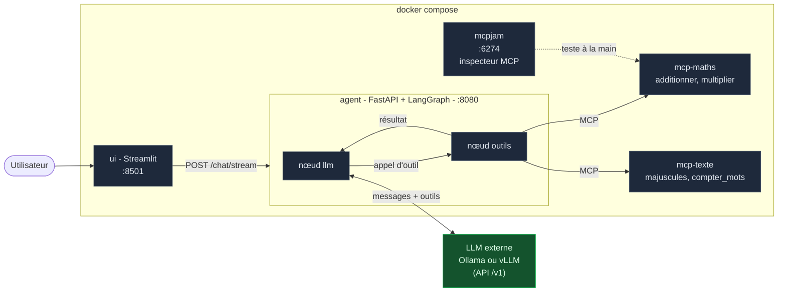

# Agent LangGraph + MCP : le squelette

Un squelette **pédagogique et réutilisable** pour brancher un ou plusieurs
serveurs **MCP** (Model Context Protocol) sur un **agent LangGraph**, avec un
LLM servi à part (Ollama ou vLLM).

Ce dépôt répond à une question : *comment donner des outils à un agent sans
réécrire de la colle pour chaque outil ?* La réponse tient en trois fichiers à
connaître : un graphe d'agent, une liste de serveurs MCP, une URL de LLM.


## Les deux branches

| Branche | Contenu |
|---|---|
| **`main`** (ici) | Le squelette générique et son tutoriel : agent LangGraph, deux serveurs MCP d'exemple, LLM externe. |
| [`exemple/calculatrice`](https://github.com/floSa/MCP_maison/tree/exemple/calculatrice) | Un cas concret : un petit LLM qui calcule uniquement via des outils MCP. |

## Démarrage rapide

Prérequis : Docker, et un LLM servi en Ollama ou vLLM
(voir [brancher un LLM](docs/03-brancher-un-llm.md)).

```bash
cp .env.example .env     # puis adapter LLM_BASE_URL et LLM_MODEL
make up                  # branche l'agent sur le service LLM central
make demo                # une question, avec la trace des appels MCP
```

Sans service LLM central : `make up-local` embarque un Ollama dans la stack.

| Interface | Adresse |
|---|---|
| Chat (Streamlit) | <http://localhost:8501> |
| API de l'agent | <http://localhost:8080/docs> |
| Outils découverts | <http://localhost:8080/outils> |
| Inspecteur MCPJam | <http://localhost:6274> |

## Comment ça marche



Trois idées à retenir :

1. **Le LLM est externe.** Aucun modèle dans ce projet : un seul service
   Ollama ou vLLM sert tous les projets. Seule l'URL change dans `.env`.
2. **Les outils viennent de serveurs MCP.** L'agent ne connaît aucun outil à
   l'avance : il les découvre dans les serveurs listés dans
   [`agent/mcp_servers.json`](agent/mcp_servers.json).
3. **L'agent est un graphe.** Deux nœuds (`llm`, `outils`) et une condition :
   la boucle *penser, agir, observer*, rendue visible.

## Tutoriel

À lire dans l'ordre :

1. [Le principe : un agent, des outils, un LLM](docs/01-principe.md)
2. [Le StateGraph de LangGraph](docs/02-state-graph.md)
3. [Brancher un LLM (Ollama ou vLLM)](docs/03-brancher-un-llm.md)
4. [Brancher un ou plusieurs serveurs MCP](docs/04-brancher-un-mcp.md)
5. [Aller plus loin (`create_agent`, Deep Agents, bonnes pratiques)](docs/05-aller-plus-loin.md)

Et aussi : [MCPJam, l'inspecteur de serveurs MCP](docs/mcpjam.md).

## Structure du dépôt

```
agent/
  graphe.py          le StateGraph (le cœur à lire en premier)
  fabrique.py        branche le LLM et les serveurs MCP sur le graphe
  evenements.py      transforme le flux LangGraph en événements simples
  config.py          LLM_BASE_URL, LLM_MODEL, liste des serveurs MCP
  mcp_servers.json   les serveurs MCP à brancher
  app.py / cli.py    API HTTP (FastAPI) et ligne de commande
mcp_servers/         deux serveurs MCP d'exemple (FastMCP)
ui/                  interface de chat Streamlit
tests/               tests avec faux LLM, et bout en bout avec le vrai
docker-compose.yml               la stack, sans LLM
docker-compose.llm-central.yml   override : se brancher sur le service LLM central
docker-compose.llm-local.yml     override : Ollama embarqué
```

## Tests

```bash
make test        # unitaires + intégration, faux LLM, quelques secondes
make test-e2e    # bout en bout avec le vrai LLM (stack démarrée)
```

Les tests rapides remplacent le LLM par un modèle scripté
([`tests/faux_llm.py`](tests/faux_llm.py)) : ils vérifient le graphe et le
câblage MCP de façon déterministe, sans GPU.
