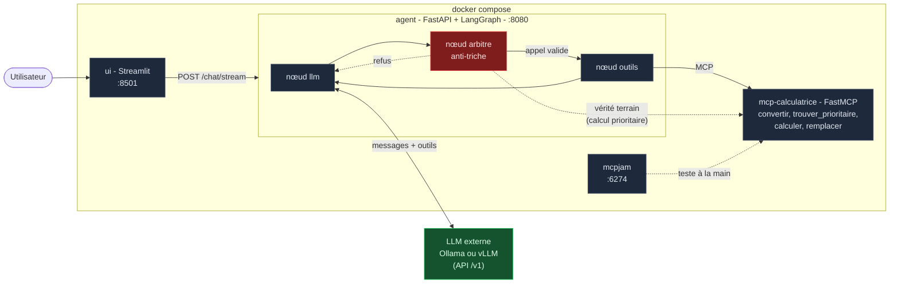

# Calculatrice : un agent LangGraph + MCP avec arbitre

Un **exemple concret** du squelette [agent LangGraph + MCP](https://github.com/floSa/MCP_maison/tree/main) :
un LLM résout des calculs posés en français — « *trois fois quatre plus deux* » —
**sans jamais calculer lui-même**. Chaque opération passe par un outil exposé
via **MCP**, et un **arbitre** (un nœud du graphe) refuse toute étape qui ne
suit pas le vrai calcul. Le LLM est externe (Ollama ou vLLM).


## Les deux branches

| Branche | Contenu |
|---|---|
| [`main`](https://github.com/floSa/MCP_maison/tree/main) | Le squelette générique et son tutoriel (principe, StateGraph, brancher un LLM ou un MCP). |
| **`exemple/calculatrice`** (ici) | Le cas concret : calculatrice + arbitre anti-triche. |

La documentation de cette branche : [la calculatrice et son arbitre](docs/calculatrice.md),
[le serveur MCP](docs/mcp.md), [MCPJam](docs/mcpjam.md).

## Démarrage rapide

Prérequis : Docker, et un LLM servi en Ollama ou vLLM (voir le tutoriel sur
`main`). Le modèle doit savoir appeler des outils (`gemma4:e4b` convient).

```bash
cp .env.example .env     # puis adapter LLM_BASE_URL et LLM_MODEL
make up                  # branche l'agent sur le service LLM central
make demo                # "trois fois quatre plus deux", trace pas à pas
```

Sans service LLM central : `make up-local` embarque un Ollama dans la stack.

| Interface | Adresse |
|---|---|
| Chat (Streamlit) | <http://localhost:8501> |
| API de l'agent | <http://localhost:8080/docs> |
| Inspecteur MCPJam | <http://localhost:6274> |

## Architecture



## Tests

```bash
make test        # outils, serveur MCP, graphe + arbitre : faux LLM, quelques secondes
make test-e2e    # bout en bout avec le vrai LLM (stack démarrée)
```
