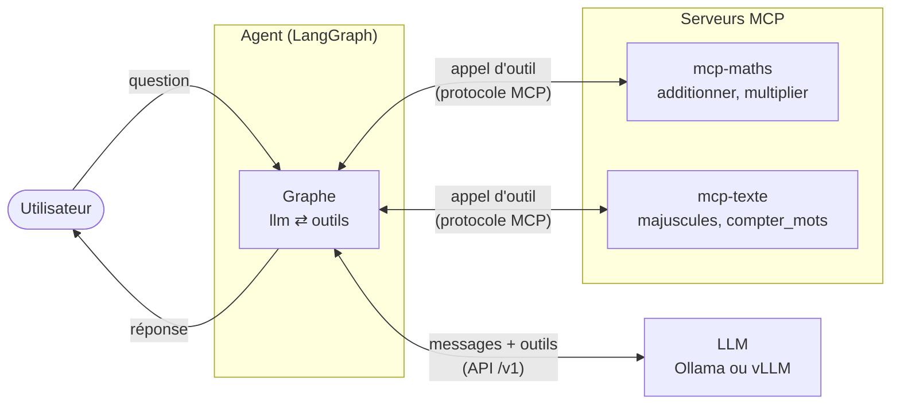
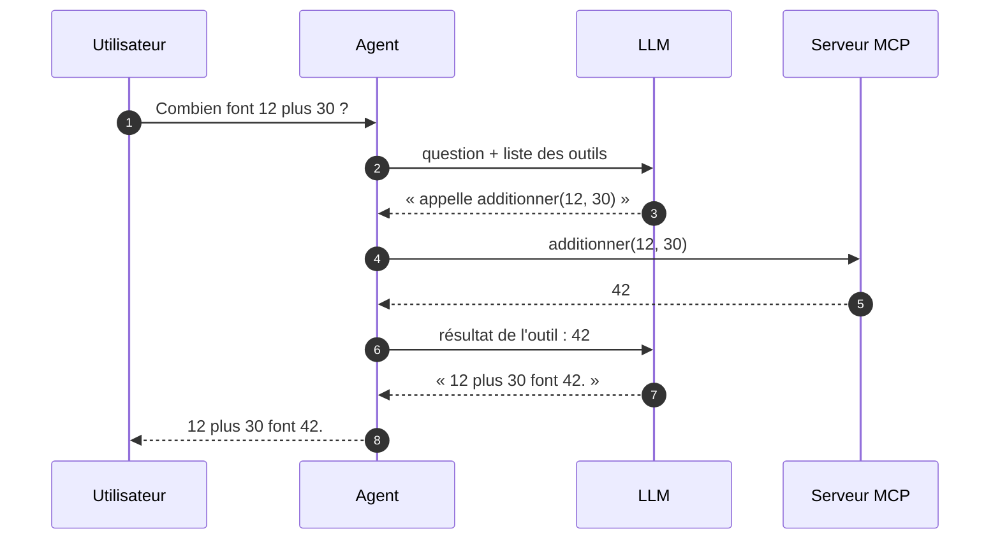

# 1. Le principe : un agent, des outils, un LLM

Ce projet montre comment **donner des outils à un LLM** (calculer, chercher,
lire un fichier…) sans modifier le code de l'agent à chaque nouvel outil.
Quatre acteurs interviennent.

## Les quatre acteurs

| Acteur | Rôle | Dans ce projet |
|---|---|---|
| **LLM** | Le « cerveau » : lit la conversation et décide quoi faire. Il ne sait qu'écrire du texte. | Ollama ou vLLM, hors de ce projet |
| **Agent** | Le « chef d'orchestre » : fait tourner la boucle entre le LLM et les outils. | `agent/` (graphe LangGraph) |
| **Serveur MCP** | Le « magasin d'outils » : publie des fonctions utilisables par un agent. | `mcp_servers/` |
| **Outil** | Une fonction concrète (`additionner`, `compter_mots`…). | Dans un serveur MCP |

## Pourquoi MCP

Sans MCP, chaque outil se branche à la main dans l'agent : il faut écrire sa
description pour le LLM, le code qui l'appelle et la gestion de ses erreurs, puis
tout recommencer pour chaque nouvel outil ou chaque framework d'agent.

**MCP (Model Context Protocol)** est un standard : un serveur MCP publie ses
outils dans un format unique (nom, description, paramètres typés). Tout agent
qui parle MCP peut alors les **découvrir** et les **appeler**, sans rien savoir
de leur implémentation.

> Analogie : MCP est à un agent ce que l'USB est à un ordinateur. Brancher un
> nouvel outil se résume à brancher un nouveau câble.

Conséquence directe dans ce projet : **le code de l'agent ne mentionne aucun
outil**. La liste des serveurs vit dans
[`agent/mcp_servers.json`](../agent/mcp_servers.json).

## Ce que fait le LLM, et ce qu'il ne fait pas

Un LLM ne « lance » jamais un outil lui-même. Il produit un message structuré
qui dit : *« je voudrais appeler `additionner` avec `a=12` et `b=30` »*. C'est
l'**agent** qui exécute réellement l'appel, puis qui rend le résultat au LLM.

Les étapes 2 à 6 forment une **boucle** : le LLM peut enchaîner plusieurs
outils avant de répondre. Cette boucle s'appelle **ReAct** (*Reason + Act* :
raisonner, agir, observer). Le chapitre suivant montre comment LangGraph la
représente.

---
Suite : [2. Le StateGraph](02-state-graph.md)
