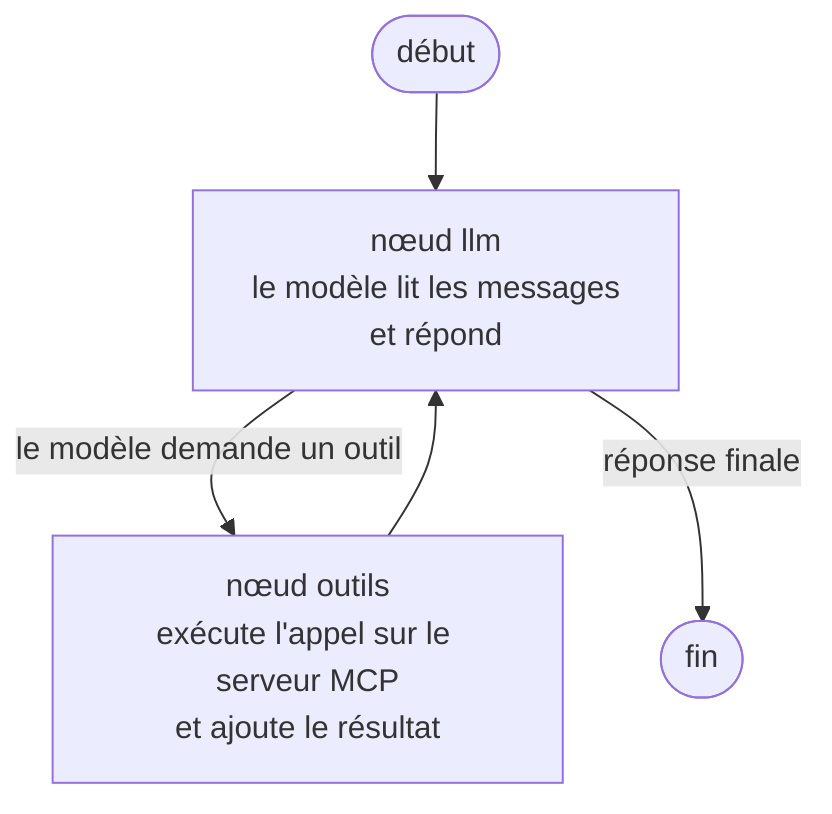

# 2. Le StateGraph de LangGraph

## En une phrase

Un **StateGraph** est un petit organigramme que LangGraph exécute : des
**boîtes** (les nœuds) reliées par des **flèches** (les arêtes), qui lisent et
complètent une **mémoire commune** (l'état).

## Les trois ingrédients

| Ingrédient | C'est quoi | Équivalent dans la vie |
|---|---|---|
| **État** | Les données partagées. Ici : la liste des messages de la conversation. | Un cahier posé sur la table, que chacun lit et complète |
| **Nœud** | Une fonction Python qui fait un travail et renvoie ce qu'elle ajoute à l'état. | Un poste de travail |
| **Arête** | Une flèche vers le nœud suivant. Elle peut être *conditionnelle*. | Un panneau « si A, aller à gauche, sinon à droite » |

## Le graphe de ce projet

Deux nœuds et une condition suffisent. Ce schéma est généré par LangGraph à
partir du vrai code (`graphe.get_graph().draw_mermaid()`) :



Lecture pas à pas, pour « Combien font 12 plus 30 ? » :

| Tour | Nœud | Ce qui se passe | État après le tour |
|---|---|---|---|
| 1 | `llm` | Le modèle répond « appelle `additionner(12, 30)` » | question, demande d'outil |
| — | condition | La réponse contient un appel d'outil, donc aller aux outils | |
| 2 | `outils` | L'appel part au serveur MCP, qui renvoie `42` | question, demande, résultat `42` |
| — | flèche | Les outils reviennent toujours au `llm` | |
| 3 | `llm` | Le modèle lit le résultat et écrit « 12 plus 30 font 42 » | … + réponse |
| — | condition | Aucun appel d'outil, donc fin | |

La **boucle** `llm → outils → llm` est la boucle ReAct. Elle se répète autant de
fois que nécessaire, jusqu'à ce que le modèle réponde sans demander d'outil.

## Le code correspondant

Tout tient dans [`agent/graphe.py`](../agent/graphe.py) :

```python
graphe = StateGraph(MessagesState)             # 1. l'état = la liste des messages

graphe.add_node("llm", noeud_llm)              # 2. deux nœuds
graphe.add_node("outils", ToolNode(outils))

graphe.add_edge(START, "llm")                  # 3. les flèches
graphe.add_conditional_edges(                  #    - condition : outil demandé ?
    "llm", tools_condition, {"tools": "outils", END: END})
graphe.add_edge("outils", "llm")               #    - les outils reviennent au llm

agent = graphe.compile()                       # 4. figer le graphe en agent exécutable
```

- `MessagesState` est un état prêt à l'emploi : une liste de messages où chaque
  nœud **ajoute** (sans remplacer).
- `ToolNode(outils)` est un nœud fourni par LangGraph : il lit les demandes
  d'outil du dernier message du modèle, les exécute, et ajoute les résultats.
- `tools_condition` est la condition fournie : « le dernier message demande-t-il
  un outil ? ».

## Pourquoi un graphe plutôt qu'une boucle `while`

Une boucle écrite à la main fonctionne (c'était le cas dans la première
version de ce projet). Le graphe apporte :

- **Lisibilité** : la structure se dessine et se vérifie d'un coup d'œil.
- **Extensibilité** : ajouter une étape (validation, relecture, humain dans la
  boucle) revient à **ajouter un nœud et une flèche**, sans réécrire la boucle.
- **Garde-fou intégré** : `recursion_limit` coupe un modèle qui bouclerait sans
  fin (voir `LIMITE_ETAPES`).
- **Observabilité** : chaque étape peut être suivie en direct. C'est ce qui
  alimente l'affichage en temps réel de l'interface (`stream_mode="updates"`,
  voir [`agent/evenements.py`](../agent/evenements.py)).

L'exemple de la branche `exemple/calculatrice` en tire parti : un nœud
supplémentaire y vérifie chaque étape du modèle.

---
Précédent : [1. Le principe](01-principe.md) · Suite : [3. Brancher un LLM](03-brancher-un-llm.md)
