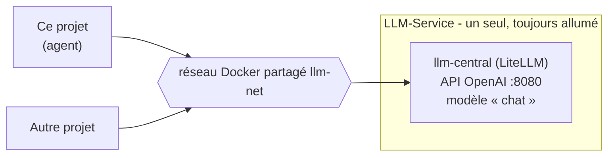

# 3. Brancher le LLM central (LLM-Service)

## Principe : un LLM partagé, pas un par projet

Lancer un serveur de LLM par projet gaspille du disque et de la VRAM. Un seul
service, **LLM-Service**, est appelé par tous les projets via le réseau Docker
externe `llm-net`.



Ce projet ne contient aucun LLM : [`docker-compose.yml`](../docker-compose.yml)
lance seulement l'agent, l'interface et les serveurs MCP.

## Réglages (`.env`)

| Variable | Valeur | Rôle |
|---|---|---|
| `LLM_BASE_URL` | `http://llm-central:8080/v1` (conteneur) ou `http://127.0.0.1:8080/v1` (hôte) | API OpenAI du service |
| `LLM_MODEL` | `chat` | Qwen3.5-4B, réflexion + vision, contexte 16 384 jetons |
| `LLM_API_KEY` | `LITELLM_MASTER_KEY` du `.env` de LLM-Service | clé obligatoire, jamais commitée |
| `LLM_EXTRA_BODY` | `{"chat_template_kwargs": {"enable_thinking": false}}` | coupe la réflexion |

Le `.env` n'est pas suivi par git ; seul [`.env.example`](../.env.example) l'est.

## Démarrage

1. Démarrer LLM-Service (crée le réseau `llm-net`).
2. `cp .env.example .env` puis renseigner `LLM_API_KEY`.
3. `make up`.

`make up` ajoute au compose de base
[`docker-compose.llm-central.yml`](../docker-compose.llm-central.yml), qui
rattache l'agent au réseau `llm-net` (`external: true`).

Le port 8080 de l'hôte étant occupé par LLM-Service, l'API de l'agent est
publiée sur **8090** (`AGENT_PORT` pour le changer).

## Réflexion désactivée

La réflexion est active par défaut sur `chat`. Pour un agent à outils, elle
allonge les réponses sans bénéfice : `LLM_EXTRA_BODY` la coupe via
`chat_template_kwargs`. Pour la réactiver, laisser `LLM_EXTRA_BODY` vide ; le
raisonnement arrive alors dans `message.reasoning_content`.

## Choisir un modèle

L'agent exige un modèle qui sait **appeler des outils** (*function calling*).
`chat` convient (essai réel : appels `additionner` puis `mettre_en_majuscules`).

## Où se fait le branchement dans le code

Une seule fonction, [`creer_modele()`](../agent/fabrique.py) :

```python
ChatOpenAI(base_url=config.LLM_BASE_URL, api_key=config.LLM_API_KEY,
           model=config.LLM_MODEL, temperature=0, extra_body=...)
```

Rien d'autre dans le projet ne connaît le LLM.

---
Précédent : [2. Le StateGraph](02-state-graph.md) · Suite : [4. Brancher un serveur MCP](04-brancher-un-mcp.md)
