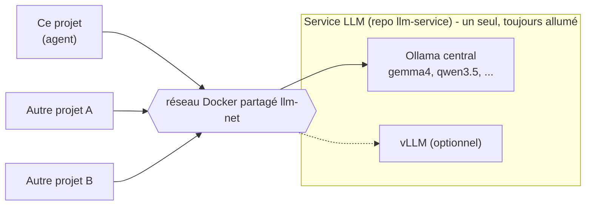

# 3. Brancher un LLM (Ollama ou vLLM)

## Principe : un LLM partagé, pas un par projet

Lancer un serveur de LLM par projet gaspille du disque (le même modèle
téléchargé N fois) et surtout de la VRAM (le même modèle chargé N fois).
L'approche retenue : **un seul service LLM**, que chaque projet appelle par le
réseau.



Ce projet ne contient donc **aucun LLM** : [`docker-compose.yml`](../docker-compose.yml)
lance seulement l'agent, l'interface et les serveurs MCP.

## Une seule API pour Ollama et vLLM

Ollama et vLLM exposent tous deux une API **compatible OpenAI** sous `/v1`. Le
client de l'agent (`ChatOpenAI`) est donc le même dans les deux cas : **seule
l'URL change**. Tout se règle dans `.env` :

| Serveur | `LLM_BASE_URL` | `LLM_MODEL` (exemple) |
|---|---|---|
| Ollama central | `http://ollama-central:11434/v1` | `gemma4:e4b` |
| vLLM | `http://<service-vllm>:8000/v1` | le nom passé à `vllm serve` |

`LLM_API_KEY` reste à `inutile`, sauf si le serveur impose une clé (vLLM lancé
avec `--api-key`).

## Cas 1 : brancher le service LLM central (défaut)

1. Démarrer le service central (une fois pour tous les projets) : `make up` dans
   le dépôt `llm-service`. Cela crée le réseau Docker `llm-net`.
2. Copier [`.env.example`](../.env.example) en `.env`, vérifier `LLM_BASE_URL` et
   `LLM_MODEL` (le modèle doit exister sur le service central : `ollama ls`).
3. Démarrer ce projet :

```bash
make up
```

Concrètement, `make up` ajoute au compose de base l'override
[`docker-compose.llm-central.yml`](../docker-compose.llm-central.yml), qui fait
une seule chose : rattacher l'agent au réseau `llm-net`. L'agent atteint alors
le LLM par son nom de service (`ollama-central`).

## Cas 2 : vLLM

Même procédure que le cas 1, avec deux différences.

- Dans `.env`, pointer vers le service vLLM et son modèle :

  ```
  LLM_BASE_URL=http://<service-vllm>:8000/v1
  LLM_MODEL=<nom du modèle servi>
  ```

- Le service vLLM doit être lancé avec l'appel d'outils activé, sans quoi le
  modèle ne pourra pas utiliser les serveurs MCP :

  ```bash
  vllm serve <modèle> --enable-auto-tool-choice --tool-call-parser <parser>
  ```

  Le `<parser>` dépend de la famille de modèle (voir la documentation vLLM,
  section *Tool Calling*).

Le service vLLM doit aussi être attaché au réseau `llm-net` pour être joignable
par son nom.

> Dans l'état actuel du dépôt `llm-service`, seul Ollama est défini dans le
> compose ; le dossier `vllm/` ne contient qu'un script d'entrée. Le support
> vLLM de ce projet est donc documenté mais n'a pas été testé de bout en bout.

## Cas 3 : pas de service central, Ollama embarqué

```bash
make up-local
```

L'override [`docker-compose.llm-local.yml`](../docker-compose.llm-local.yml)
ajoute un conteneur Ollama à la stack et télécharge `LLM_MODEL` au premier
démarrage. À réserver aux machines sans service central : chaque projet lancé
ainsi charge son propre exemplaire du modèle.

Sans GPU nvidia, supprimer le bloc `deploy` de cet override ; l'inférence passe
alors sur CPU, bien plus lentement.

## Choisir un modèle

L'agent exige un modèle qui sait **appeler des outils** (*function calling*).
`gemma4:e4b`, `qwen3.5:9b` et `granite4.2:8b` conviennent. Un modèle trop petit
(autour de 1,5 milliard de paramètres) rate régulièrement ses appels d'outils.

## Où se fait le branchement dans le code

Une seule fonction, [`creer_modele()`](../agent/fabrique.py) :

```python
ChatOpenAI(base_url=config.LLM_BASE_URL, api_key=config.LLM_API_KEY,
           model=config.LLM_MODEL, temperature=0)
```

Rien d'autre dans le projet ne connaît le LLM.

---
Précédent : [2. Le StateGraph](02-state-graph.md) · Suite : [4. Brancher un serveur MCP](04-brancher-un-mcp.md)
