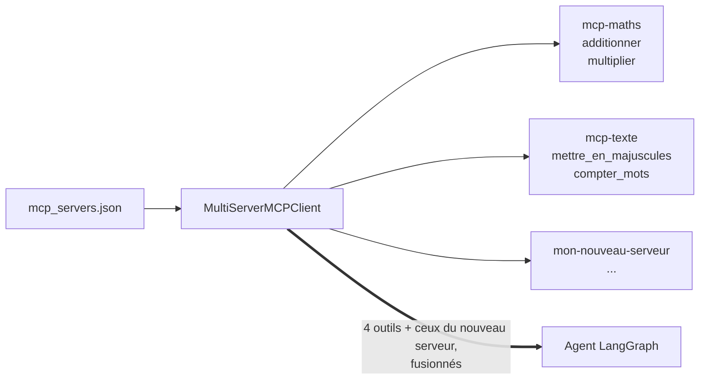

# 4. Brancher un ou plusieurs serveurs MCP

## Où se déclarent les serveurs

Dans un seul fichier : [`agent/mcp_servers.json`](../agent/mcp_servers.json).

```json
{
  "maths": { "transport": "streamable_http", "url": "http://mcp-maths:8000/mcp/" },
  "texte": { "transport": "streamable_http", "url": "http://mcp-texte:8000/mcp/" }
}
```

Chaque entrée est un serveur : un **nom** (libre) et l'**adresse** où il
répond. À chaque question, l'agent se connecte à tous les serveurs de la liste,
récupère leurs outils, **les fusionne en une seule liste** et la présente au
LLM. Le modèle choisit l'outil qui convient, quel que soit son serveur
d'origine.



## Cas A : un serveur MCP qui existe déjà (HTTP)

Ajouter une entrée au fichier JSON, puis reconstruire l'agent :

```json
"mon-serveur": { "transport": "streamable_http", "url": "http://mon-serveur:8000/mcp/" }
```

```bash
docker compose -f docker-compose.yml -f docker-compose.llm-central.yml up -d --build agent
```

Le serveur doit être joignable depuis le conteneur de l'agent : même réseau
Docker, ou URL publique. Contrôle immédiat : `curl localhost:8080/outils` doit
lister les nouveaux outils.

## Cas B : écrire son propre serveur MCP

Un serveur MCP, avec FastMCP, tient en quelques lignes. Voir
[`mcp_servers/texte.py`](../mcp_servers/texte.py) pour un exemple complet :

```python
from fastmcp import FastMCP

mcp = FastMCP(name="meteo")

@mcp.tool
def temperature(ville: str) -> float:
    """Renvoie la température actuelle d'une ville, en °C. Exemple : « Lyon » -> 18.5."""
    ...

if __name__ == "__main__":
    mcp.run(transport="http", host="0.0.0.0", port=8000)
```

Trois points comptent :

- **Le nom de la fonction, ses types et sa docstring forment la description de
  l'outil.** C'est tout ce que le LLM voit pour décider de l'utiliser : une
  docstring claire avec un exemple améliore nettement les appels.
- **Les annotations de types** (`ville: str`) deviennent le schéma des
  paramètres.
- **Peu d'outils, bien distincts.** Dix outils aux rôles qui se chevauchent
  troublent un petit modèle.

Pour l'ajouter à la stack :

1. Poser le fichier dans `mcp_servers/` et le copier dans le
   [`Dockerfile`](../mcp_servers/Dockerfile).
2. Ajouter un service dans [`docker-compose.yml`](../docker-compose.yml), calqué
   sur `mcp-texte` (commande `python meteo.py`).
3. Ajouter l'entrée dans `agent/mcp_servers.json`.
4. Reconstruire : `make up`.

Avant de brancher l'agent, tester le serveur seul avec
[MCPJam](mcpjam.md) : si l'outil répond bien à la main, les problèmes
éventuels viendront du modèle et non du serveur.

## Cas C : un serveur MCP en `stdio`

De nombreux serveurs MCP publics se lancent comme un programme local (`npx …`,
`uvx …`) et non comme un service HTTP. Le client le gère :

```json
"fichiers": { "transport": "stdio", "command": "npx", "args": ["-y", "@modelcontextprotocol/server-filesystem", "/data"] }
```

Attention : le programme s'exécute **dans le conteneur de l'agent**, qui ne
contient aujourd'hui que Python. Il faudrait y installer Node (ou `uvx`) pour
cet usage.

## Les erreurs d'outil

Si un outil échoue (`raise ToolError("...")` côté serveur), le message revient
au LLM comme résultat de l'appel, et le graphe continue : le modèle peut
corriger ses arguments ou expliquer le problème. Des messages d'erreur clairs
côté serveur sont donc une vraie aide pour l'agent.

---
Précédent : [3. Brancher un LLM](03-brancher-un-llm.md) · Suite : [5. Aller plus loin](05-aller-plus-loin.md)
