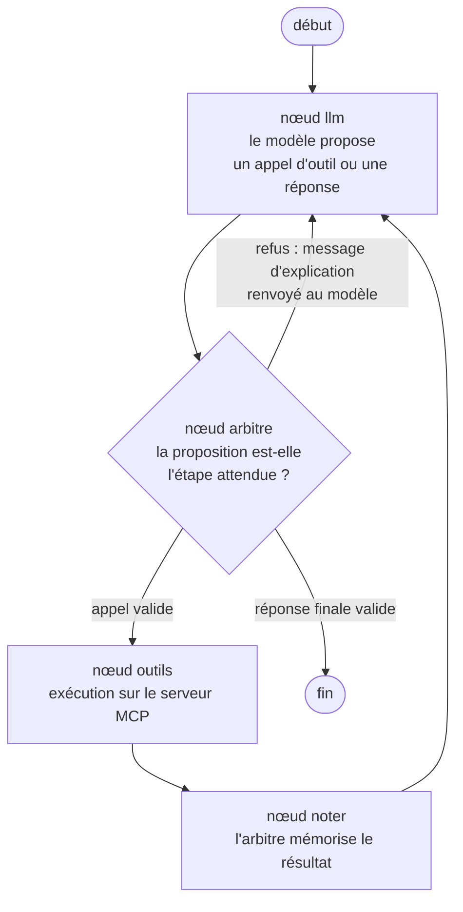
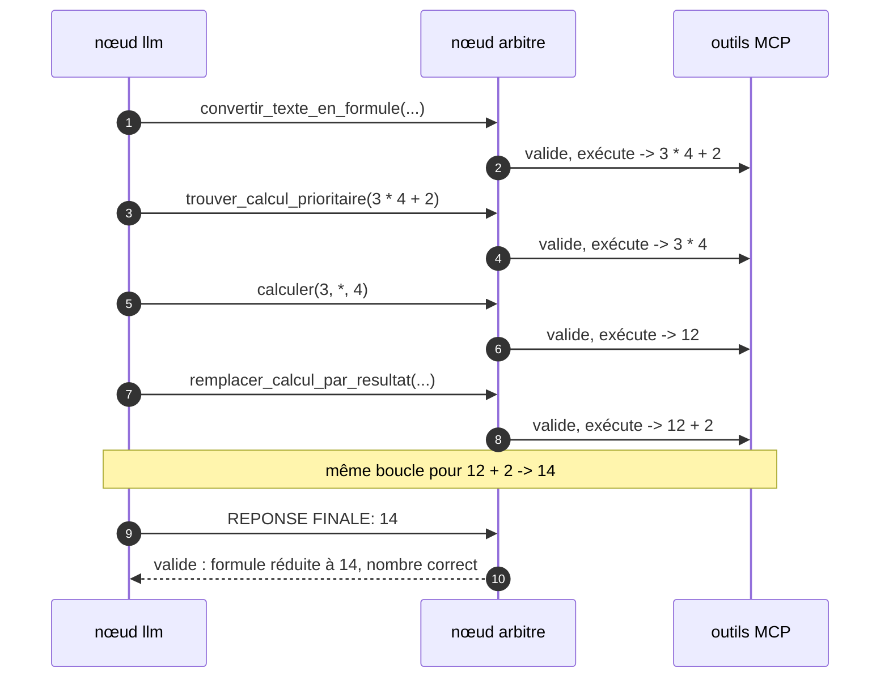

# La calculatrice : un exemple complet avec arbitre

Cette branche applique le squelette de `main` à un cas concret : **un LLM qui
résout des calculs posés en français sans jamais calculer lui-même**.

> « trois fois quatre plus deux » -> `14`, où chaque opération est faite par un
> outil MCP, et où une réponse donnée « de tête » est refusée.

Le tutoriel général (principe, StateGraph, brancher un LLM ou un MCP) se trouve
sur la branche [`main`](https://github.com/floSa/MCP-Agent-Test-Bench/tree/main). Ce
document se concentre sur ce que la calculatrice ajoute.

## Pourquoi un arbitre

Un LLM **croit** faire juste, même quand il se trompe : il peut annoncer `14`
sans avoir rien calculé, ou enchaîner les étapes dans le mauvais ordre. Pour un
calcul, on veut une garantie, pas un espoir.

Le principe : **le LLM propose, le code dispose.** Un composant déterministe, l'
**arbitre**, vérifie chaque proposition avant qu'elle ait un effet.

## Le graphe : le squelette plus deux nœuds



Comparé à `main` (`llm ⇄ outils`), deux nœuds s'ajoutent :

| Nœud | Rôle |
|---|---|
| **arbitre** | Examine ce que le modèle vient de proposer. Appel d'outil : est-ce l'étape attendue, avec les bons arguments ? Réponse finale : la formule a-t-elle été réduite à un seul nombre par les outils, et le nombre annoncé est-il le bon ? Sinon, un **refus** explicatif est renvoyé au modèle. |
| **noter** | Après un outil réussi, met à jour la mémoire de l'arbitre (formule courante, dernier résultat). |

L'aiguillage après l'arbitre tient dans une fonction de trois lignes
(`apres_arbitre`, dans [`agent/graphe.py`](../agent/graphe.py)) : appel validé,
réponse validée, ou refus.

## Les outils MCP

Quatre étapes déterministes, plus un secours (voir
[le tutoriel du serveur MCP](mcp.md)) :

| Outil | Rôle |
|---|---|
| `convertir_texte_en_formule` | « trois fois quatre plus deux » -> `3 * 4 + 2` |
| `trouver_calcul_prioritaire` | Quelle opération faire en premier (priorités `*` `/` avant `+` `-`) ? |
| `calculer` | Une seule opération binaire : `3 * 4` -> `12` |
| `remplacer_calcul_par_resultat` | `3 * 4 + 2` -> `12 + 2` |
| `convertir_texte_en_formule_libre` | Secours : un LLM propose la formule pour une formulation inhabituelle, **revalidée par le code déterministe** |

`calculer` n'accepte que **deux opérandes** : le modèle ne peut pas faire un
calcul à plusieurs étapes de tête, il doit passer par la boucle d'outils.

## Déroulé de « trois fois quatre plus deux »



## Ce que l'arbitre refuse

| Tentative du modèle | Réaction de l'arbitre |
|---|---|
| Répondre `14` sans avoir utilisé d'outil | « aucune formule n'a été construite » |
| `calculer(4, +, 2)` alors que le calcul prioritaire est `3 * 4` | « ce n'est pas le calcul prioritaire » |
| Remplacer par une valeur différente du résultat de `calculer` | « cette valeur n'est pas le résultat renvoyé » |
| Annoncer `15` alors que la formule réduite vaut `14` | « ce nombre ne correspond pas à la formule réduite » |
| Demander plusieurs outils dans le même tour | « appelle UN seul outil par tour » |

Pour savoir quel est le **vrai** calcul prioritaire, l'arbitre interroge
lui-même le serveur MCP (`trouver_calcul_prioritaire`) : la vérité vient du code,
pas de ce que le modèle affirme.

Ces scénarios sont des tests automatiques
([`tests/test_graphe_arbitre.py`](../tests/test_graphe_arbitre.py)), joués avec un
faux LLM scripté : un modèle honnête est validé, un tricheur est bloqué.

## Lancer l'exemple

```bash
cp .env.example .env
make up      # ou make up-local pour un Ollama embarqué
make demo    # "trois fois quatre plus deux", avec la trace pas à pas
```

Interface de chat : <http://localhost:8501>. Dans la trace, les refus de
l'arbitre apparaissent en rouge entre les appels MCP.

## Fichiers à lire

| Fichier | Contenu |
|---|---|
| [`agent/graphe.py`](../agent/graphe.py) | Le graphe : les quatre nœuds et l'aiguillage |
| [`agent/arbitre.py`](../agent/arbitre.py) | Les règles de vérification, sans dépendance à LangGraph |
| [`mcp_servers/calculatrice.py`](../mcp_servers/calculatrice.py) | Le serveur MCP |
| [`mcp_servers/outils_calcul.py`](../mcp_servers/outils_calcul.py) | Les outils en Python pur |
| [`tests/`](../tests) | Outils, serveur MCP, graphe + arbitre, bout en bout |
